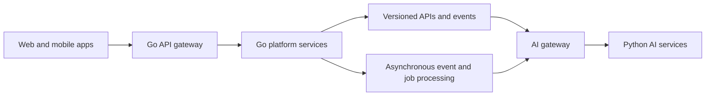

<p align="center">
  
</p>

<h1 align="center">EDU247</h1>

<p align="center">
  A connected learning platform for learners, educators, creators, and institutions.
</p>

<p align="center">
  <a href="#what-is-edu247">About</a> ·
  <a href="#get-started">Get started</a> ·
  <a href="#platform-architecture">Architecture</a> ·
  <a href="#project-status">Project status</a>
</p>

---

## What is EDU247?

EDU247 is being built to bring learning, teaching, creator tools, and educational commerce together in one platform. The project is designed as a modular monorepo: a Go-powered platform core, with dedicated Python services for AI workloads.

This repository is actively evolving. The web experience is the most complete application today; platform services and AI integrations described below represent the intended architecture and are not all implemented yet.

## Explore the platform

The web app introduces EDU247 to its main audiences:

- **Learners** — discover learning paths and manage learning activity.
- **Teachers** — explore teaching tools and classroom workflows.
- **Creators and developers** — find ways to build, contribute, and share.
- **Vendors and institutions** — learn about marketplace and organizational experiences.

The current web experience includes public information pages, account and onboarding previews, and role-based dashboard interfaces. See the [web app guide](apps/web/README.md) for routes, design details, and known limitations.

## Get started

### Requirements

- Node.js 22 or later
- npm

### Run the web app locally

```bash
cd apps/web
npm ci
npm run dev
```

Open [http://localhost:3000](http://localhost:3000).

### Check the web app

From `apps/web`, run:

```bash
npm run lint
npm run build
```

The current Go gateway directory is an early scaffold. Platform APIs and Python AI services are not yet available as locally runnable services in this repository.

## Platform architecture

EDU247 separates core platform responsibilities from AI workloads so each can be developed, deployed, and scaled independently.



### Go platform boundary

Go is the target language for the API gateway, authentication and identity, learning and course management, assignments, progress, notifications, marketplace, payments, administration, analytics, integrations, and non-AI background workers.

### Python AI boundary

Python is reserved for dedicated AI services, including tutoring, lesson and media generation, recommendation models, code review, security analysis, and documentation generation. Core platform logic remains outside this boundary.

### Service communication

- Public REST APIs are described with versioned OpenAPI contracts.
- Internal gRPC APIs use Protocol Buffers where appropriate.
- Asynchronous messages use versioned event schemas.
- Each service owns its data; services access other service data through approved APIs or events, not direct database access.
- Go services submit authorized AI jobs through the AI gateway. AI services return job status, output references, safety results, and model metadata.
- Long-running generation jobs are designed to support retries, monitoring, cancellation, and independent scaling.

## Project status

| Area | Status |
| --- | --- |
| EDU247 web experience | Implemented as a Next.js, React, and TypeScript app in `apps/web` |
| API gateway | Early Go scaffold in `gateway` |
| Platform microservices | Planned; not yet implemented |
| Python AI services | Planned; not yet implemented |
| Service contracts and event schemas | Part of the target architecture; not yet established throughout the repository |
| GitHub Pages | Web app build and deployment workflow is configured |

**Frontend previews are not production services.** Sign-in, registration, password recovery, and onboarding are not connected to an authentication backend. Newsletter validation happens in the browser only. Dashboards expect role-specific API endpoints; without a separately deployed API, they show an API-unavailable state. GitHub Pages hosts the static web app only, not backend APIs.

## Repository map

```text
.
├── apps/
│   └── web/                 # Next.js public site and platform UI
├── gateway/                 # Go API gateway scaffold
├── .github/
│   └── workflows/           # Web lint, build, and Pages deployment
├── .env.example             # Environment-variable template
├── LICENSE
└── README.md
```

As the platform grows, the intended monorepo will also add Go services and shared packages, Python AI services, API and event contracts, database migrations, infrastructure, deployment configurations, and broader test suites.

## Engineering principles

- **Clear boundaries:** Go owns core platform behavior; Python is limited to AI workloads.
- **Contract first:** APIs and events have explicit, versioned contracts.
- **Service ownership:** each service owns its data and its operational lifecycle.
- **Security and privacy:** enforce identity, tenant, role, and consent on the server; keep secrets out of source control; moderate and audit generated content.
- **Observable by default:** services should expose structured logs, metrics, traces, health checks, and audit events.
- **Quality before release:** build confidence with unit, contract, integration, end-to-end, accessibility, performance, security, and AI evaluation tests as each capability is introduced.

## Deployment

The web app is configured for static export and GitHub Pages deployment. Pull requests to `main` run lint and build checks; pushes to `main` build and deploy the site.

To enable dashboard requests to an API hosted separately, configure the repository Actions variable `NEXT_PUBLIC_EDU247_API_BASE_URL`. The API must allow browser requests from the published site origin and implement the dashboard contract documented in the [web app guide](apps/web/README.md). GitHub Pages itself does not host APIs.

## Contributing

Contributions are welcome as the project takes shape. Before opening a pull request:

1. Keep changes focused and follow the Go/Python service boundaries above.
2. Run the relevant checks for the area you changed.
3. Update the closest documentation when behavior or setup changes.
4. Never commit credentials, secrets, or private user data.

Please use the repository's [pull request template](.github/PULL_REQUEST_TEMPLATE.md) when proposing a change.

## License

See [LICENSE](LICENSE).
